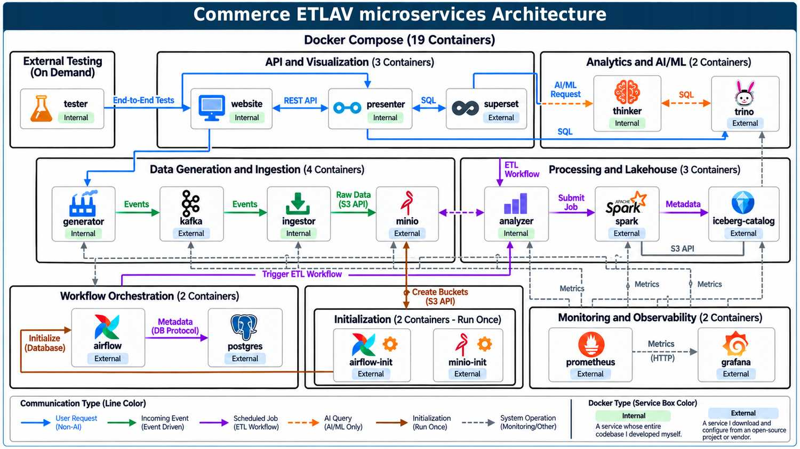

# CommerceETLAV

## Main README Overview

- [Project Summary](#project-summary)
- [Target Audience](#target-audience)
- [Project Architecture](#project-architecture)
- [Project Documentation](#project-documentation)
- [Table of Contents](#table-of-contents)
- [Diagram Index](#diagram-index)
- [Table Index](#table-index)

## Project Summary

**Extract → Transform → Load → Analyze → Visualize**

CommerceETLAV is a local, open-source commerce data POC application. \
It demonstrates Big Data, ETL, data warehousing/lakehouse, analytics and AI/ML. \
The project follows commerce data from generation to visualization, query and end-to-end tests. \
It covers streaming, ingestion, storage, transformation, structured analysis, AI/ML analysis and APIs.

> **Project Status:** Planning / Initial Development

## Target Audience

CommerceETLAV is designed for three main audiences:

- **Reviewer / Interviewer** — An employer who wants to learn about my software engineering abilities from the project.
- **Demo User** — Anyone who wants to see a small project using Big Data, ETL, data warehouse/lakehouse concepts, analytics, and AI/ML.
- **Developer** — Anyone who wants to build a similar project using Big Data, ETL, data warehouse/lakehouse concepts, analytics, and AI/ML.

How to use CommerceETLAV by user type

- **Reviewer / Interviewer** — Explore the project's goals, architecture, technologies, and engineering decisions.
- **Demo User** — Run the demo, generate data, and explore analytics and AI/ML capabilities.
- **Developer** — Understand the services, development workflow, testing strategy, and implementation details.

## Project Architecture

## Project Documentation

- [Project Goals](docs/goals.md) — Purpose, scope, and objectives.
- [Project Architecture](docs/architecture.md) — Services, data flows, and technologies.
- [User Guide](docs/user-guide.md) — Installation, operations, analytics, and testing.
- [Development Process](docs/development-process.md) — Principles, lifecycle, testing, and roadmap.
- [Additional Documents](docs/additional-documents.md) — Documentation strategy and future plans.

## Table of Contents

Table of Contents for the entire documentation, including `README.md` and all documents in the `docs` folder. 

- [1. Project Goals](docs/goals.md#1-project-goals)
  - [1.1 Project Description](docs/goals.md#11-project-description)
  - [1.2 Project Demonstrates](docs/goals.md#12-project-demonstrates)
  - [1.3 Project Scope](docs/goals.md#13-project-scope)
  - [1.4 Security Scope](docs/goals.md#14-security-scope)
  - [1.5 Structured Analytics](docs/goals.md#15-structured-analytics)
  - [1.6 AI/ML Analysis](docs/goals.md#16-aiml-analysis)
  - [1.7 Combined Analysis](docs/goals.md#17-combined-analysis)

- [2. Project Architecture](docs/architecture.md#2-project-architecture)
  - [2.1 Data Flow](docs/architecture.md#21-data-flow)
  - [2.2 Analysis Flow](docs/architecture.md#22-analysis-flow)
  - [2.3 Complete System](docs/architecture.md#23-complete-system)
  - [2.4 Application Services](docs/architecture.md#24-application-services)
  - [2.5 Infrastructure Services](docs/architecture.md#25-infrastructure-services)
  - [2.6 Data Components](docs/architecture.md#26-data-components)
  - [2.7 Technology Stack](docs/architecture.md#27-technology-stack)
  - [2.8 Running Services](docs/architecture.md#28-running-services)
  - [2.9 Security Boundary](docs/architecture.md#29-security-boundary)
  - [2.10 Commerce Data Model](docs/architecture.md#210-commerce-data-model)
  - [2.11 Docker Topology](docs/architecture.md#211-docker-topology)
  - [2.12 Docker Architecture](docs/architecture.md#212-docker-architecture)
  - [2.13 Docker Communication by Trigger](docs/architecture.md#213-docker-communication-by-trigger)
  - [2.14 Docker Communication by Protocol](docs/architecture.md#214-docker-communication-by-protocol)
  - [2.15 Microservices Architecture](docs/architecture.md#215-microservices-architecture)

- [3. User Guide](docs/user-guide.md#3-user-guide)
  - [3.1 Quick Start](docs/user-guide.md#31-quick-start)
  - [3.2 Expected Startup](docs/user-guide.md#32-expected-startup)
  - [3.3 System Operations](docs/user-guide.md#33-system-operations)
  - [3.4 Generate Data](docs/user-guide.md#34-generate-data)
  - [3.5 Structured Queries](docs/user-guide.md#35-structured-queries)
  - [3.6 AI/ML Queries](docs/user-guide.md#36-aiml-queries)
  - [3.7 Combined Queries](docs/user-guide.md#37-combined-queries)
  - [3.8 Website and APIs](docs/user-guide.md#38-website-and-apis)
  - [3.9 Running Tests](docs/user-guide.md#39-running-tests)

- [4. Development Process](docs/development-process.md#4-development-process)
  - [4.1 Project Principles](docs/development-process.md#41-project-principles)
  - [4.2 Development Lifecycle](docs/development-process.md#42-development-lifecycle)
  - [4.3 Definition of Done](docs/development-process.md#43-definition-of-done)
  - [4.4 Testing Strategy](docs/development-process.md#44-testing-strategy)
  - [4.5 Project Status](docs/development-process.md#45-project-status)
  - [4.6 Project Roadmap](docs/development-process.md#46-project-roadmap)
  - [4.7 Repository Responsibilities](docs/development-process.md#47-repository-responsibilities)

- [5. Additional Documents](docs/additional-documents.md#5-additional-documents)
  - [5.1 Documentation Strategy](docs/additional-documents.md#51-documentation-strategy)
  - [5.2 Documentation Evolution](docs/additional-documents.md#52-documentation-evolution)
  - [5.3 Planned Documents](docs/additional-documents.md#53-planned-documents)

## Diagram Index

| Diagram | Title | Section |
|---|---|---|
| 2.1 | Data Flow | [2.1 Data Flow](docs/architecture.md#21-data-flow) |
| 2.2 | Analysis Flow | [2.2 Analysis Flow](docs/architecture.md#22-analysis-flow) |
| 2.3 | Complete System | [2.3 Complete System](docs/architecture.md#23-complete-system) |
| 2.4 | Security Extension | [2.9 Security Boundary](docs/architecture.md#29-security-boundary) |
| 2.5 | Docker Architecture | [2.12 Docker Architecture](docs/architecture.md#212-docker-architecture) |
| 2.6 | Docker Communication by Trigger | [2.13 Docker Communication by Trigger](docs/architecture.md#213-docker-communication-by-trigger) |
| 2.7 | Docker Communication by Protocol | [2.14 Docker Communication by Protocol](docs/architecture.md#214-docker-communication-by-protocol) |
| 2.8 | Microservices Architecture | [2.15 Microservices Architecture](docs/architecture.md#diagram-28--microservices-architecture) |
| 3.1 | Test Flow | [3.9 Running Tests](docs/user-guide.md#39-running-tests) |
| 4.1 | Development Lifecycle | [4.2 Development Lifecycle](docs/development-process.md#42-development-lifecycle) |
| 4.2 | Tenant Test Flow | [4.4 Testing Strategy](docs/development-process.md#44-testing-strategy) |
| 5.1 | Documentation Evolution | [5.2 Documentation Evolution](docs/additional-documents.md#52-documentation-evolution) |

## Table Index

| Table | Title | Section |
|---|---|---|
| 2.1 | Application Services | [2.4 Application Services](docs/architecture.md#24-application-services) |
| 2.2 | Infrastructure Services | [2.5 Infrastructure Services](docs/architecture.md#25-infrastructure-services) |
| 2.3 | Technology Stack | [2.7 Technology Stack](docs/architecture.md#27-technology-stack) |
| 2.4 | Running Services | [2.8 Running Services](docs/architecture.md#28-running-services) |
| 2.5 | Docker Architecture | [2.12 Docker Architecture](docs/architecture.md#212-docker-architecture) |
| 2.6 | Docker Communication by Trigger | [2.13 Docker Communication by Trigger](docs/architecture.md#213-docker-communication-by-trigger) |
| 2.7 | Docker Communication by Protocol | [2.14 Docker Communication by Protocol](docs/architecture.md#214-docker-communication-by-protocol) |
| 2.8 | Microservices Architecture | [2.15 Microservices Architecture](docs/architecture.md#215-microservices-architecture) |
| 4.1 | Project Status | [4.5 Project Status](docs/development-process.md#45-project-status) |
| 4.2 | Project Roadmap | [4.6 Project Roadmap](docs/development-process.md#46-project-roadmap) |
| 4.3 | Repository Responsibilities | [4.7 Repository Responsibilities](docs/development-process.md#47-repository-responsibilities) |

