# 2. Project Architecture

The project's main architecture diagram is [Diagram 2.8](#diagram-28--microservices-architecture).\
It includes both Markdown (`.md`) and image (`.jpg`) versions of the same diagram.\
Showing the Docker containers/services and their communication/API connections.

## Table of contents

**2. Project Architecture**
- [2. Project Architecture](#2-project-architecture)
  - [2.1 Data Flow](#21-data-flow)
  - [2.2 Analysis Flow](#22-analysis-flow)
  - [2.3 Complete System](#23-complete-system)
  - [2.4 Application Services](#24-application-services)
  - [2.5 Infrastructure Services](#25-infrastructure-services)
  - [2.6 Data Components](#26-data-components)
  - [2.7 Technology Stack](#27-technology-stack)
  - [2.8 Running Services](#28-running-services)
  - [2.9 Security Boundary](#29-security-boundary)
  - [2.10 Commerce Data Model](#210-commerce-data-model)
  - [2.11 Docker Topology](#211-docker-topology)
    - [Docker and Roles](#docker-and-roles)
    - [Docker Communications](#docker-communications)
    - [Architecture Decisions](#architecture-decisions)
  - [2.12 Docker Architecture](#212-docker-architecture)
    - [Diagram 2.5 Color Legend](#diagram-25-color-legend)
  - [2.13 Docker Communication by Trigger](#213-docker-communication-by-trigger)
    - [Diagram 2.6 Color Legend](#diagram-26-color-legend)
    - [Diagram Notes](#diagram-notes)
    - [Implementation Note](#implementation-note)
  - [2.14 Docker Communication by Protocol](#214-docker-communication-by-protocol)
    - [Diagram 2.7 — Docker Communication by Protocol](#diagram-27--docker-communication-by-protocol)
    - [Diagram 2.7 Color Legend](#diagram-27-color-legend)
    - [Communication Notes](#communication-notes)
  - [2.15 Microservices Architecture](#215-microservices-architecture)
    - [Diagram 2.8 — Microservices Architecture](#diagram-28--microservices-architecture)
    - [Diagram 2.8 — JPG image](#diagram-28-jpg-image)
    - [Diagram 2.8 Color Legend](#diagram-28-color-legend)

---

## 2.1 Data Flow

CommerceETLAV is composed of independently containerized application services and established open-source infrastructure products.

The complete environment is managed by `commerce-etlav-manager` and runs locally using Docker Compose.

**Diagram 2.1 — Data Flow**

```text
Generator
    ↓
  Kafka
    ↓
Ingestor
    ↓
  MinIO
    ↓
Analyzer / Spark
    ↓
 Iceberg
    ↓
  Trino
    ↓
Presenter
    ↓
 Website
```

The main flow follows commerce data from its creation to its final presentation.

## 2.2 Analysis Flow

Structured analytics and AI/ML analysis operate on the same commerce data but solve different types of problems.

**Diagram 2.2 — Analysis Flow**

```text
                Curated Data
                     │
            ┌────────┴────────┐
            ▼                 ▼
          Trino             Thinker
     SQL Analytics         AI / ML
            │                 │
            └────────┬────────┘
                     ▼
                 Presenter
                     ▼
                  Website
```

Trino handles structured analytical queries.

Thinker handles AI/ML and semantic analysis.

Presenter combines their results behind the public application API.

## 2.3 Complete System

The complete system contains CommerceETLAV microservices, third-party infrastructure services, data components, monitoring, UI, and external testing.

**Diagram 2.3 — Complete System**

```text
                           CommerceETLAV
┌─────────────────────────────────────────────────────────────────────────────┐
│                                                                             │
│  DATA GENERATION AND INGESTION                                              │
│                                                                             │
│  ┌───────────┐      ┌─────────┐      ┌──────────┐                           │
│  │ Generator │ ───► │  Kafka  │ ───► │ Ingestor │                           │
│  └───────────┘      └─────────┘      └────┬─────┘                           │
│                                           │                                 │
│                                           ▼                                 │
│                                      ┌─────────┐                            │
│                                      │  MinIO  │                            │
│                                      │Data Lake│                            │
│                                      └────┬────┘                            │
│                                           │                                 │
│  PROCESSING AND STORAGE                   ▼                                 │
│                                                                             │
│                                  ┌──────────────────┐                       │
│                                  │ Analyzer / Spark │                       │
│                                  └────────┬─────────┘                       │
│                                           │                                 │
│                                           ▼                                 │
│                                  ┌──────────────────┐                       │
│                                  │ Iceberg / Parquet│                       │
│                                  └────────┬─────────┘                       │
│                                           │                                 │
│                         ┌─────────────────┴─────────────────┐               │
│                         ▼                                   ▼               │
│                  ┌────────────┐                       ┌───────────┐         │
│                  │   Trino    │                       │  Thinker  │         │
│                  │ SQL Query  │                       │  AI / ML  │         │
│                  └─────┬──────┘                       └─────┬─────┘         │
│                        │                                    │               │
│                        └────────────────┬───────────────────┘               │
│                                         ▼          │                        │
│                                  ┌─────────────┐   │                        │
│                                  │  Presenter  │   │                        │
│                                  │ Public API  │   │                        │
│                                  └──────┬──────┘   │                        │
│                                         │          │                        │
│                              ┌──────────┴          │                        │
│                              ▼                     ▼                        │
│                       ┌────────────┐         ┌────────────┐                 │
│                       │  Website   │         │  Superset  │                 │
│                       │ Demo UI    │         │ BI / Charts│                 │
│                       └────────────┘         └────────────┘                 │
│                                                                             │
│  ORCHESTRATION                       OBSERVABILITY                          │
│                                                                             │
│  ┌────────────┐                      ┌────────────┐   ┌────────────┐        │
│  │  Airflow   │                      │  Grafana   │──►│  Prometheus│        │
│  │ Workflows  │                      │  Dashboard │   │ Metrics    │        │
│  └────────────┘                      └────────────┘   └────────────┘        │
│                                                                             │
└────────────────────────────────────────────────────────────────────────────-┘
                    ▲                                  ▲
                    │                                  │
                    └──────────┐            ┌──────────┘
                               │            │
                         ┌─────┴────────────┴─────┐
                         │      E2E Tester        │
                         │ REST / Selenium Tests  │
                         └────────────────────────┘
```

The Tester remains outside the system boundary and validates the system as an external client.

## 2.4 Application Services

**Table 2.1 — Application Services**

| # | Repository | Service Role | Responsibility |
|---:|---|---|---|
| 1 | `commerce-etlav-manager` | Management | Integrates the complete project, infrastructure, configuration, scripts, Docker Compose, and documentation |
| 2 | `commerce-etlav-generator` | Generation | Generates deterministic commerce data and events |
| 3 | `commerce-etlav-ingestor` | Ingestion | Consumes events and persists incoming commerce data |
| 4 | `commerce-etlav-analyzer` | Analytics | Performs structured ETL and analytical processing |
| 5 | `commerce-etlav-thinker` | AI/ML | Performs AI/ML and semantic analysis |
| 6 | `commerce-etlav-presenter` | Gateway | Provides the public backend API and application gateway |
| 7 | `commerce-etlav-website` | Visualization | Provides the user-facing web application |
| 8 | `commerce-etlav-tester` | Testing | Performs external black-box E2E testing |

Note 1: commerce-etlav-manager isn't a docker or application running in production.
Instead, it contains the docker-compose and every other resource and config that enable to run the entire project locally.

Note 2: Each application repository owns its application source code and Dockerfile.

## 2.5 Infrastructure Services

**Table 2.2 — Infrastructure Services**

| # | Product | Role | Responsibility |
|---:|---|---|---|
| 1 | Apache Kafka | Streaming | Provides the event stream between producers and consumers |
| 2 | MinIO | Data Lake | Provides local S3-compatible object storage |
| 3 | Apache Spark | Processing | Performs distributed data transformation and processing |
| 4 | Trino | SQL Query | Executes distributed SQL queries over curated data |
| 5 | Apache Airflow | Orchestration | Schedules and coordinates data workflows |
| 6 | Apache Superset | BI | Provides analytical dashboards and business visualization |
| 7 | Prometheus | Metrics | Collects system and application metrics |
| 8 | Grafana | Monitoring | Visualizes operational metrics and system health |
| 9 | Apache Iceberg | Tabular data | A high-performance table format over cloud data lakes |
| 10 | PostgreSQL | RDBMS | An object-relational database with SQL |

Infrastructure configuration and required infrastructure Dockerfiles are owned by `commerce-etlav-manager`.

Note: Two additional Docker containers only initialize data/configuration and then exit. 
This is their sole purpose; unlike the other containers, they do not continue running in production. 
They do not appear in either of the two tables, but they do appear in the Docker and Roles table.

## 2.6 Data Components

The main data components are:

- **Parquet** — column-oriented physical data format optimized for analytical workloads.
- **Apache Iceberg** — table format providing schemas, metadata, snapshots, and table management over data files.
- **MinIO objects** — physical storage for raw and processed data.

Parquet and Iceberg are data technologies rather than independent running microservices.

The intended storage relationship is:

```text
MinIO
  │
  ├── Raw Data
  │
  └── Curated Data
        │
        └── Iceberg Tables
              │
              └── Parquet Files
```

## 2.7 Technology Stack

**Table 2.3 — Technology Stack**

| # | Area | Technology | Purpose |
|---:|---|---|---|
| 1 | Application Backend | Java / Spring Boot | Generator, Ingestor, Presenter, and related backend services |
| 2 | AI/ML Backend | Python / FastAPI | Thinker AI/ML service |
| 3 | Frontend | React / TypeScript | CommerceETLAV Website |
| 4 | Streaming | Apache Kafka | Commerce event streaming |
| 5 | Object Storage | MinIO | Local data lake |
| 6 | Data Format | Parquet | Analytical file storage |
| 7 | Table Format | Apache Iceberg | Lakehouse table management |
| 8 | Data Processing | Apache Spark | Distributed ETL and processing |
| 9 | SQL Analytics | Trino | Distributed analytical SQL |
| 10 | Orchestration | Apache Airflow | Pipeline scheduling and coordination |
| 11 | BI | Apache Superset | Business dashboards |
| 12 | Metrics | Prometheus | Metrics collection |
| 13 | Monitoring | Grafana | Operational dashboards |
| 14 | Containers | Docker | Service packaging |
| 15 | Integration | Docker Compose | Complete local system execution |
| 16 | API Testing | Java / Python | Black-box REST E2E testing |
| 17 | UI Testing | Selenium | Black-box Website E2E testing |

The project prefers technologies that are:

- Open source.
- Popular and recognizable.
- Appropriate for their architectural role.
- Locally runnable.
- Simple enough to demonstrate and explain.

## 2.8 Running Services

The exact ports will be finalized during implementation.

**Table 2.4 — Running Services**

| # | Service | Role | Type | Protocol / Address | Description |
|---:|---|---|---|---|---|
| 1 | Generator | Generate | Microservice — Java / Spring Boot | HTTP / `localhost:<port>` | Generates commerce data and events |
| 2 | Kafka | Stream | Infrastructure — Apache Kafka | Kafka / `localhost:<port>` | Provides the commerce event stream |
| 3 | Ingestor | Ingest | Microservice — Java / Spring Boot | HTTP / `localhost:<port>` | Consumes and persists incoming events |
| 4 | MinIO | Store | Infrastructure — MinIO | HTTP / `localhost:<port>` | Stores raw and processed data |
| 5 | Spark | Transform | Infrastructure — Apache Spark | HTTP UI / `localhost:<port>` | Executes distributed ETL processing |
| 6 | Analyzer | Analyze | Microservice | HTTP / `localhost:<port>` | Coordinates structured analytical processing |
| 7 | Trino | Query | Infrastructure — Trino | HTTP / `localhost:<port>` | Executes SQL analytics |
| 8 | Thinker | AI/ML | Microservice — Python / FastAPI | HTTP / `localhost:<port>` | Performs semantic and AI/ML analysis |
| 9 | Presenter | Gateway | Microservice — Java / Spring Boot | HTTP / `localhost:<port>` | Provides the public backend API |
| 10 | Website | Visualize | Microservice — React / TypeScript | HTTP / `localhost:<port>` | Provides the main user interface |
| 11 | Superset | BI | Infrastructure — Apache Superset | HTTP / `localhost:<port>` | Provides analytical dashboards |
| 12 | Airflow | Orchestrate | Infrastructure — Apache Airflow | HTTP / `localhost:<port>` | Coordinates data workflows |
| 13 | Prometheus | Metrics | Infrastructure — Prometheus | HTTP / `localhost:<port>` | Collects operational metrics |
| 14 | Grafana | Monitor | Infrastructure — Grafana | HTTP / `localhost:<port>` | Displays operational dashboards |
| 15 | Tester | Test | External test application | CLI / optional HTTP | Executes black-box E2E scenarios |
| 16 | Iceberg Catalog | Catalog | Infrastructure — Iceberg REST Catalog | HTTP / `localhost:<port>` | Manages Iceberg table metadata |
| 17 | PostgreSQL | Metadata | Infrastructure — PostgreSQL | PostgreSQL / `localhost:<port>` | Stores Airflow and Superset metadata |


## 2.9 Security Boundary

The Tester and normal clients should interact with CommerceETLAV through documented public interfaces.

Tests should not depend on internal Kafka topics, MinIO files, Iceberg metadata, or other implementation details to determine whether a scenario succeeded.

API authentication and authorization can later be added at the Presenter / Gateway boundary.

**Diagram 2.4 — Security Extension**

```text
Website
    │
    ▼
Presenter / Gateway
    │
    ├── Authentication
    ├── API Authorization
    │
    ▼
Internal Services
```

This allows basic API security to be added without redesigning the Big Data pipeline.

## 2.10 Commerce Data Model

The data model represents understandable commerce concepts such as:

- Customers.
- Products.
- Sessions.
- Searches.
- Product views.
- Shopping carts.
- Orders.
- Purchases.
- Returns.
- Reviews.

Events contain mostly structured fields and at least one optional free-text field.

Example:

```json
{
  "eventId": "e-10042",
  "timestamp": "2026-09-20T18:42:10Z",
  "customerId": "c-104",
  "productId": "p-42",
  "sessionId": "s-992",
  "eventType": "PRODUCT_REVIEW",
  "country": "CA",
  "price": 129.99,
  "rating": 2,
  "text": "Battery stopped charging after one week."
}
```

Structured fields support SQL and traditional analytics.

Free-text fields support semantic AI/ML analysis.


## 2.11 Docker Topology

CommerceETLAV uses Docker Compose to run the complete platform locally.

The proposed final architecture contains **19 Docker containers**:

- **7 application containers** — CommerceETLAV microservices, Website, and Tester.
- **12 infrastructure containers** — third-party services, metadata storage, and initialization utilities.

In production:
- 16 containers run continuously. 6 dockers I created and 10 are third party.
- 2 containers run only during initialization: airflow-init and minio-init.
- 1 container runs only during testing. It is the end-to-end tester I created.

The architecture is designed for a single-machine, non-production demonstration.

The goals are:

- Run the complete platform using one Docker Compose configuration.
- Keep application services independently containerized.
- Use established open-source infrastructure products.
- Minimize unnecessary containers and operational complexity.
- Make service dependencies and communication explicit.
- Allow incremental development and integration.
- Avoid production-specific complexity such as clustering, replication, and high availability.

### Docker and Roles

**Table — Docker and Roles**

| # | Container | Application / Service | Role |
|---:|---|---|---|
| 1 | `generator` | Java / Spring Boot | Generate deterministic commerce events |
| 2 | `ingestor` | Java / Spring Boot | Consume Kafka events and store raw data |
| 3 | `analyzer` | Spark-based processing application | Transform, clean, aggregate, and write curated data |
| 4 | `thinker` | Python / FastAPI | Perform AI/ML semantic analysis |
| 5 | `presenter` | Java / Spring Boot | Provide the public REST API and application gateway |
| 6 | `website` | React / Web Server | Provide the user-facing interface |
| 7 | `tester` | Java / Python + Selenium | Execute external black-box E2E tests |
| 8 | `kafka` | Apache Kafka / KRaft | Provide the event streaming broker |
| 9 | `minio` | MinIO | Provide S3-compatible object storage |
| 10 | `spark` | Apache Spark | Execute distributed ETL jobs in local mode |
| 11 | `iceberg-catalog` | Iceberg REST Catalog | Manage Iceberg table metadata |
| 12 | `trino` | Trino | Query Iceberg tables using SQL |
| 13 | `airflow` | Apache Airflow | Schedule and coordinate data workflows |
| 14 | `superset` | Apache Superset | Provide BI dashboards and SQL visualization |
| 15 | `prometheus` | Prometheus | Collect and store application and infrastructure metrics |
| 16 | `grafana` | Grafana | Provide operational monitoring dashboards |
| 17 | `postgres` | PostgreSQL | Store metadata for Airflow and Superset |
| 18 | `airflow-init` | Airflow Initialization | Initialize and migrate the Airflow metadata database |
| 19 | `minio-init` | MinIO Client | Initialize buckets and storage configuration |

**Container Notes**

1. **Manager Repository**
   - `commerce-etlav-manager` is a GitHub repository, not a running container.
   - It owns the main `docker-compose.yml`, infrastructure configuration, and maintenance scripts.

2. **Application Containers**
   - Each CommerceETLAV application repository owns its application code and Dockerfile.
   - Application containers can be built and updated independently.

3. **Tester Container**
   - `tester` is an external black-box testing application.
   - It runs on demand and exits when testing is complete.
   - It validates the platform through documented public APIs and the Website.

4. **Initialization Containers**
   - `airflow-init` and `minio-init` execute during environment initialization.
   - They exit after their initialization tasks finish successfully.

5. **Data Components**
   - Parquet is a physical file format.
   - Apache Iceberg is a table format.
   - Neither requires a dedicated processing container.
   - The Iceberg REST Catalog is a separate service that manages table metadata.

6. **Kafka**
   - Kafka uses KRaft mode.
   - A separate ZooKeeper container is not required.

7. **Spark**
   - Spark initially runs in local mode.
   - Separate Spark worker containers are not required.
   - The relationship between `analyzer` and `spark` will be finalized during implementation.

8. **PostgreSQL**
   - One PostgreSQL container supports both Airflow and Superset.
   - Each application uses a separate database or schema.

9. **Deployment Scope**
   - The topology does not include production clustering, replication, or high availability.
   - Additional exporters or supporting services may be introduced if required.

10. **Container Count**
    - The 19-container architecture is a proposed final topology.
    - The actual count may change as implementation decisions are finalized.

### Docker Communications

Containers communicate through Docker Compose networking.

Internal services should use Docker Compose service names rather than fixed container IP addresses.

For example:

```text
kafka:9092
minio:9000
trino:8080
thinker:8000
presenter:8080
```

Only services that require access from a browser, developer machine, or external client should publish ports to the host.

**Table — Docker Communications**

| # | Source | Destination | Protocol | Purpose |
|---:|---|---|---|---|
| 1 | Generator | Kafka | Kafka TCP | Publish commerce events |
| 2 | Ingestor | Kafka | Kafka TCP | Consume commerce events |
| 3 | Ingestor | MinIO | S3 API / HTTP | Store raw commerce data |
| 4 | Analyzer | Spark | Spark Job Submission | Execute ETL processing |
| 5 | Spark | MinIO | S3 API / HTTP | Read raw data and write Parquet files |
| 6 | Spark | Iceberg Catalog | REST / HTTP | Resolve and update Iceberg table metadata |
| 7 | Iceberg Catalog | MinIO | S3 API / HTTP | Access table metadata and storage |
| 8 | Trino | Iceberg Catalog | REST / HTTP | Discover Iceberg tables and metadata |
| 9 | Trino | MinIO | S3 API / HTTP | Read curated Parquet data |
| 10 | Thinker | Trino | SQL / HTTP | Retrieve structured data for AI/ML analysis |
| 11 | Presenter | Trino | SQL / HTTP | Execute structured analytical queries |
| 12 | Presenter | Thinker | REST / HTTP | Request AI/ML insights |
| 13 | Website | Presenter | REST / HTTP | Request application data |
| 14 | Presenter | Generator | REST / HTTP | Trigger commerce data generation |
| 15 | Presenter | Analyzer | REST / HTTP | Trigger or inspect analytical processing |
| 16 | Airflow | Analyzer | REST / HTTP | Trigger processing workflows |
| 17 | Airflow | PostgreSQL | PostgreSQL TCP | Store orchestration metadata |
| 18 | Superset | Trino | SQL / HTTP | Execute analytical queries |
| 19 | Superset | PostgreSQL | PostgreSQL TCP | Store BI dashboard metadata |
| 20 | Prometheus | Application Services | HTTP `/actuator/prometheus` or `/metrics` | Collect application metrics |
| 21 | Prometheus | Infrastructure Exporters | HTTP `/metrics` | Collect supported infrastructure metrics |
| 22 | Grafana | Prometheus | HTTP API | Query operational metrics |
| 23 | Tester | Presenter | REST / HTTP | Execute public API E2E tests |
| 24 | Tester | Generator | REST / HTTP | Test Generator before Presenter is implemented |
| 25 | Tester | Website | HTTP / WebDriver | Execute browser-based E2E tests |
| 26 | `airflow-init` | PostgreSQL | PostgreSQL TCP | Initialize the Airflow metadata database |
| 27 | `minio-init` | MinIO | S3 API / HTTP | Create required storage buckets |

**Communication Notes**

1. **Internal Networking**
   - Containers use Docker Compose DNS and service names.
   - Internal communication does not require publishing ports to the host.

2. **Public Gateway**
   - Presenter is the primary public backend API.
   - Website communicates with Presenter to retrieve data and execute supported operations.
   - Browser-based requests require a browser-accessible address or reverse proxy.

3. **Event Streaming**
   - Generator publishes commerce events to Kafka.
   - Ingestor consumes those events and persists raw data in MinIO.

4. **Data Processing**
   - Analyzer coordinates structured ETL processing.
   - Spark reads raw data from MinIO and writes curated data using Parquet and Iceberg.
   - The exact Analyzer-to-Spark job execution mechanism will be selected during implementation.

5. **Lakehouse Metadata**
   - Spark and Trino communicate with the Iceberg REST Catalog.
   - Both access the underlying data stored in MinIO.
   - The Catalog implementation and its metadata persistence configuration will be finalized during implementation.

6. **Structured Analytics**
   - Trino executes SQL queries against curated Iceberg tables.
   - Presenter uses Trino for application-level structured analytics.
   - Superset can query Trino directly for BI dashboards.

7. **AI/ML Analysis**
   - Thinker can retrieve structured analytical data from Trino.
   - Presenter invokes Thinker through its REST API.
   - Combined analysis connects structured analytical results with semantic AI/ML insights.

8. **Workflow Orchestration**
   - Airflow coordinates data-processing workflows.
   - It can trigger Analyzer operations and track workflow execution.
   - Airflow stores its orchestration metadata in PostgreSQL.

9. **Observability**
   - Prometheus collects metrics from supported application and infrastructure endpoints.
   - Grafana queries Prometheus to display operational dashboards.
   - Infrastructure services without native Prometheus endpoints may require exporters.

10. **External Testing**
    - Tester interacts with documented public APIs and the Website.
    - It should not directly inspect Kafka, MinIO, Iceberg, or other internal data stores to determine test success.
    - During early milestones, Tester may access Generator directly before Presenter exists.

11. **Initialization**
    - `airflow-init` prepares the Airflow metadata database.
    - `minio-init` creates required storage buckets and configuration.
    - These containers are not continuously running services.

12. **Security Scope**
    - Production authentication and authorization are intentionally excluded from the initial demo.
    - API authentication and authorization can later be added at the Presenter / Gateway boundary.
    - UI permissions can be added independently to the Website.
    - Data-level and contextual authorization require additional design and are outside the initial scope.

### Architecture Decisions

The following decisions should be finalized during implementation:

- **Analyzer and Spark** — whether Analyzer remains a separate service or executes directly inside the Spark container.
- **Iceberg Catalog** — which REST Catalog implementation and metadata persistence approach to use.
- **Airflow Deployment** — whether a single Airflow container is sufficient or separate scheduler/API components are required.
- **AI/ML Runtime** — which local AI/ML libraries or models Thinker will use and whether additional model-serving infrastructure is necessary.
- **Metrics Exporters** — which infrastructure components require separate exporters.
- **Public Ports** — which services expose localhost ports and which remain internal.
- **Resource Limits** — memory and CPU allocation for a practical single-machine demonstration.

The objective is to preserve a simple, understandable, and runnable Docker Compose environment while demonstrating the complete Big Data and AI/ML architecture.


## 2.12 Docker Architecture

**Diagram 2.5 — Docker Architecture**

```mermaid
flowchart TB

    %% ==========================================
    %% COMMERCE ETLAV - DOCKER ARCHITECTURE
    %% 19 containers
    %% ==========================================

    subgraph SYSTEM["CommerceETLAV - Docker Compose"]

        direction TB

        subgraph INGEST["Data Generation and Ingestion"]
            direction LR
            generator["generator"]
            kafka["kafka"]
            ingestor["ingestor"]
            minio["minio"]
        end

        subgraph PROCESS["Processing and Lakehouse"]
            direction LR
            analyzer["analyzer"]
            spark["spark"]
            catalog["iceberg-catalog"]
        end

        subgraph ANALYTICS["Analytics and AI/ML"]
            direction LR
            trino["trino"]
            thinker["thinker"]
        end

        subgraph PRESENTATION["API and Visualization"]
            direction LR
            presenter["presenter"]
            website["website"]
            superset["superset"]
        end

        subgraph ORCHESTRATION["Workflow Orchestration"]
            direction LR
            airflow["airflow"]
            postgres["postgres"]
        end

        subgraph OBSERVABILITY["Monitoring and Observability"]
            direction LR
            prometheus["prometheus"]
            grafana["grafana"]
        end

        subgraph INITIALIZATION["Initialization - Run Once"]
            direction LR
            airflow_init["airflow-init"]
            minio_init["minio-init"]
        end
    end

    subgraph TESTING["External Testing - On Demand"]
        tester["tester"]
    end

    %% ==========================================
    %% DATA GENERATION AND INGESTION
    %% ==========================================

    generator -->|Publish events| kafka
    kafka -->|Consume events| ingestor
    ingestor -->|Write raw data| minio

    %% ==========================================
    %% DATA PROCESSING
    %% ==========================================

    analyzer -->|Submit ETL jobs| spark
    spark <-->|Read and write data| minio
    spark -->|Table metadata| catalog
    catalog -->|Object storage| minio

    %% ==========================================
    %% ANALYTICS
    %% ==========================================

    trino -->|Table metadata| catalog
    trino -->|Read Parquet data| minio
    thinker -->|SQL queries| trino

    %% ==========================================
    %% API AND VISUALIZATION
    %% ==========================================

    website -->|REST API| presenter
    presenter -->|Generate data| generator
    presenter -->|Trigger processing| analyzer
    presenter -->|SQL analytics| trino
    presenter -->|AI/ML insights| thinker
    superset -->|SQL queries| trino

    %% ==========================================
    %% ORCHESTRATION AND METADATA
    %% ==========================================

    airflow -->|Trigger workflows| analyzer
    airflow -->|Metadata| postgres
    superset -->|Metadata| postgres

    %% ==========================================
    %% OBSERVABILITY
    %% ==========================================

    prometheus -.->|Scrape metrics| generator
    prometheus -.->|Scrape metrics| ingestor
    prometheus -.->|Scrape metrics| analyzer
    prometheus -.->|Scrape metrics| thinker
    prometheus -.->|Scrape metrics| presenter
    prometheus -.->|Infrastructure metrics| kafka
    prometheus -.->|Infrastructure metrics| spark
    grafana -->|Query metrics| prometheus

    %% ==========================================
    %% INITIALIZATION
    %% ==========================================

    airflow_init -->|Initialize database| postgres
    minio_init -->|Create buckets| minio

    %% ==========================================
    %% EXTERNAL TESTING
    %% ==========================================

    tester -->|REST E2E tests| presenter
    tester -->|Early milestone tests| generator
    tester -->|Selenium UI tests| website

    %% ==========================================
    %% CONTAINER COLORS
    %% ==========================================

    classDef application fill:#DBEAFE,stroke:#2563EB,color:#1E3A8A,stroke-width:2px
    classDef infrastructure fill:#E5E7EB,stroke:#6B7280,color:#111827,stroke-width:2px
    classDef testing fill:#FED7AA,stroke:#EA580C,color:#7C2D12,stroke-width:2px
    classDef initialization fill:#D1FAE5,stroke:#059669,color:#065F46,stroke-width:2px

    class generator,ingestor,analyzer,thinker,presenter,website application
    class kafka,minio,spark,catalog,trino,airflow,superset,prometheus,grafana,postgres infrastructure
    class tester testing
    class airflow_init,minio_init initialization
```



#### Diagram 2.5 Color Legend

| Color | Category |  instances | When Running |
|---|---|---|---|
| 🔵 Blue | Application | 6 | continuously running containers |
| ⚪ Gray | Infrastructure | 10 | continuously running containers |
| 🟠 Orange  | Tester | 1 |  on-demand container |
| 🟢 Green | Initialization | 2 | one-time containers |

Architecture Notes
- Every node represents exactly one Docker container.
- Solid arrows represent service communication.
- Dashed arrows represent monitoring and metrics collection.
- Tester is outside the main system boundary.
- Manager, Parquet files, and Iceberg tables are not separate containers.
- The Analyzer-to-Spark connection represents the proposed architecture.
- Prometheus connections show representative metrics targets, not every possible target.


## 2.13 Docker Communication by Trigger

**Diagram 2.6 — Docker Communication by Trigger**

```mermaid
flowchart TB

    %% ==========================================
    %% COMMERCE ETLAV - DOCKER COMMUNICATION
    %% 19 containers, colored by trigger
    %% ==========================================

    subgraph SYSTEM["CommerceETLAV - Docker Compose"]
        direction TB

        subgraph INGEST["Data Generation and Ingestion"]
            direction LR
            generator["generator"]
            kafka["kafka"]
            ingestor["ingestor"]
            minio["minio"]
        end

        subgraph PROCESS["Processing and Lakehouse"]
            direction LR
            analyzer["analyzer"]
            spark["spark"]
            catalog["iceberg-catalog"]
        end

        subgraph ANALYTICS["Analytics and AI/ML"]
            direction LR
            trino["trino"]
            thinker["thinker"]
        end

        subgraph PRESENTATION["API and Visualization"]
            direction LR
            presenter["presenter"]
            website["website"]
            superset["superset"]
        end

        subgraph ORCHESTRATION["Workflow Orchestration"]
            direction LR
            airflow["airflow"]
            postgres["postgres"]
        end

        subgraph OBSERVABILITY["Monitoring and Observability"]
            direction LR
            prometheus["prometheus"]
            grafana["grafana"]
        end

        subgraph INITIALIZATION["Initialization - Run Once"]
            direction LR
            airflow_init["airflow-init"]
            minio_init["minio-init"]
        end
    end

    subgraph TESTING["External Testing - On Demand"]
        tester["tester"]
    end

    %% ==========================================
    %% USER REQUESTS - BLUE
    %% ==========================================

    website e1@-->|REST API| presenter
    presenter e2@-->|Start generation| generator
    presenter e3@-->|Trigger processing| analyzer
    presenter e4@-->|SQL analytics| trino
    superset e5@-->|SQL queries| trino
    tester e6@-->|REST E2E tests| presenter
    tester e7@-->|Generator tests| generator
    tester e8@-->|Selenium UI tests| website

    %% ==========================================
    %% AI-ONLY QUERIES - ORANGE
    %% ==========================================

    presenter e9@-->|AI/ML request| thinker
    thinker e10@-->|Analytical SQL| trino

    %% ==========================================
    %% INCOMING EVENTS - GREEN
    %% ==========================================

    generator e11@-->|Publish events| kafka
    kafka e12@-->|Consume events| ingestor
    ingestor e13@-->|Write raw data| minio

    %% ==========================================
    %% SCHEDULED JOBS - PURPLE
    %% ==========================================

    airflow e14@-->|Trigger ETL workflow| analyzer
    analyzer e15@-->|Submit Spark job| spark
    spark e16@<-->|Read/write lakehouse| minio
    spark e17@-->|Iceberg metadata| catalog

    %% ==========================================
    %% SYSTEM OPERATIONS - GRAY
    %% ==========================================

    catalog e18@-->|Object storage| minio
    trino e19@-->|Table metadata| catalog
    trino e20@-->|Read Parquet| minio

    airflow e21@-->|Metadata DB| postgres
    superset e22@-->|Metadata DB| postgres

    prometheus e23@-.->|Scrape metrics| generator
    prometheus e24@-.->|Scrape metrics| ingestor
    prometheus e25@-.->|Scrape metrics| analyzer
    prometheus e26@-.->|Scrape metrics| thinker
    prometheus e27@-.->|Scrape metrics| presenter
    prometheus e28@-.->|Kafka metrics| kafka
    prometheus e29@-.->|Spark metrics| spark
    grafana e30@-->|Query metrics| prometheus

    %% ==========================================
    %% INITIALIZATION - BROWN
    %% ==========================================

    airflow_init e31@-->|Initialize database| postgres
    minio_init e32@-->|Create buckets| minio

    %% ==========================================
    %% CONTAINER STYLE - NEUTRAL
    %% ==========================================

    classDef container fill:#F8FAFC,stroke:#334155,color:#0F172A,stroke-width:1.5px

    class generator,kafka,ingestor,minio container
    class analyzer,spark,catalog container
    class trino,thinker container
    class presenter,website,superset container
    class airflow,postgres container
    class prometheus,grafana container
    class airflow_init,minio_init,tester container

    %% ==========================================
    %% EDGE COLORS - COMMUNICATION TRIGGERS
    %% ==========================================

    classDef userEdge stroke:#2563EB,stroke-width:2.5px,color:#2563EB
    classDef eventEdge stroke:#059669,stroke-width:2.5px,color:#059669
    classDef scheduledEdge stroke:#7C3AED,stroke-width:2.5px,color:#7C3AED
    classDef systemEdge stroke:#64748B,stroke-width:2px,color:#64748B
    classDef initEdge stroke:#92400E,stroke-width:2.5px,color:#92400E
    classDef aiEdge stroke:#EA580C,stroke-width:2.5px,color:#EA580C

    class e1,e2,e3,e4,e5,e6,e7,e8 userEdge
    class e9,e10 aiEdge
    class e11,e12,e13 eventEdge
    class e14,e15,e16,e17 scheduledEdge
    class e18,e19,e20,e21,e22,e23,e24,e25,e26,e27,e28,e29,e30 systemEdge
    class e31,e32 initEdge
```



#### Diagram 2.6 Color Legend

| Color | Trigger Category | Meaning |
|---|---|---|
| 🔵 Blue | User Request | User-driven or shared AI/non-AI requests |
| 🟢 Green | Incoming Event | Event-driven ingestion and processing |
| 🟣 Purple | Scheduled Job | Scheduled ETL and orchestration |
| ⚪ Gray | System Operation | Internal infrastructure and monitoring |
| 🟤 Brown | Initialization | One-time setup operations |
| 🟠 Orange | AI Query | Communication exclusively used for AI/ML |


#### Diagram Notes
There are 32 communication links between the 19 Docker containers.
The colors represent the proposed primary trigger for each connection.
One architectural detail is worth noting: Analyzer → Spark can also be initiated by a user request.
Similarly, Spark → MinIO can occur during either scheduled or user-triggered processing.
For readability, these shared connections are purple in this version, representing the scheduled ETL path.
The same applies to internal Trino connections, which are gray because they serve multiple query types.

#### Implementation Note
The diagram uses Mermaid edge IDs (e1@-->) and edge classes to color individual connections.
This requires a Mermaid version supporting edge IDs and edge classes.
If your GitHub renderer does not support them, we can use linkStyle with numbered edge indexes instead.

## 2.14 Docker Communication by Protocol

### Diagram 2.7 — Docker Communication by Protocol

This diagram shows communication between the 19 Docker containers.

- All containers use the same neutral color.
- Communication lines are colored by network protocol.
- Colors do not represent triggers, business purposes, or AI usage.
- Spark Submission is marked TBD until its protocol is selected.

```mermaid
flowchart TB

    %% ==========================================
    %% COMMERCE ETLAV - DOCKER COMMUNICATION
    %% 19 containers, 32 communication links
    %% ==========================================

    subgraph SYSTEM["CommerceETLAV - Docker Compose"]
        direction TB

        subgraph INGEST["Data Generation and Ingestion"]
            direction LR
            generator["generator"]
            kafka["kafka"]
            ingestor["ingestor"]
            minio["minio"]
        end

        subgraph PROCESS["Processing and Lakehouse"]
            direction LR
            analyzer["analyzer"]
            spark["spark"]
            catalog["iceberg-catalog"]
        end

        subgraph ANALYTICS["Analytics and AI/ML"]
            direction LR
            trino["trino"]
            thinker["thinker"]
        end

        subgraph PRESENTATION["API and Visualization"]
            direction LR
            presenter["presenter"]
            website["website"]
            superset["superset"]
        end

        subgraph ORCHESTRATION["Workflow Orchestration"]
            direction LR
            airflow["airflow"]
            postgres["postgres"]
        end

        subgraph OBSERVABILITY["Monitoring and Observability"]
            direction LR
            prometheus["prometheus"]
            grafana["grafana"]
        end

        subgraph INITIALIZATION["Initialization - Run Once"]
            direction LR
            airflow_init["airflow-init"]
            minio_init["minio-init"]
        end
    end

    subgraph TESTING["External Testing - On Demand"]
        tester["tester"]
    end

    %% ==========================================
    %% HTTP / HTTPS - BLUE
    %% ==========================================

    website e1@-->|REST API| presenter
    presenter e2@-->|Start generation| generator
    presenter e3@-->|Trigger processing| analyzer
    presenter e4@-->|SQL over HTTP| trino
    superset e5@-->|SQL over HTTP| trino

    tester e6@-->|REST E2E tests| presenter
    tester e7@-->|Generator tests| generator
    tester e8@-->|Browser HTTP| website

    presenter e9@-->|AI/ML request| thinker
    thinker e10@-->|SQL over HTTP| trino

    ingestor e13@-->|S3 API| minio

    spark e16@<-->|S3 API| minio
    spark e17@-->|Catalog API| catalog

    catalog e18@-->|S3 API| minio
    trino e19@-->|Catalog API| catalog
    trino e20@-->|S3 API| minio

    airflow e14@-->|REST API| analyzer

    prometheus e23@-.->|HTTP metrics| generator
    prometheus e24@-.->|HTTP metrics| ingestor
    prometheus e25@-.->|HTTP metrics| analyzer
    prometheus e26@-.->|HTTP metrics| thinker
    prometheus e27@-.->|HTTP metrics| presenter
    prometheus e28@-.->|HTTP metrics| kafka
    prometheus e29@-.->|HTTP metrics| spark
    grafana e30@-->|Prometheus HTTP API| prometheus

    minio_init e32@-->|S3 API| minio

    %% ==========================================
    %% KAFKA PROTOCOL - GREEN
    %% ==========================================

    generator e11@-->|Publish events| kafka
    kafka e12@-->|Consume events| ingestor

    %% ==========================================
    %% POSTGRESQL PROTOCOL - PURPLE
    %% ==========================================

    airflow e21@-->|PostgreSQL| postgres
    superset e22@-->|PostgreSQL| postgres
    airflow_init e31@-->|PostgreSQL| postgres

    %% ==========================================
    %% SPARK SUBMISSION - ORANGE (TBD)
    %% ==========================================

    analyzer e15@-->|Spark Submission TBD| spark

    %% ==========================================
    %% CONTAINER STYLE - NEUTRAL
    %% ==========================================

    classDef container fill:#F8FAFC,stroke:#334155,color:#0F172A,stroke-width:1.5px

    class generator,kafka,ingestor,minio container
    class analyzer,spark,catalog container
    class trino,thinker container
    class presenter,website,superset container
    class airflow,postgres container
    class prometheus,grafana container
    class airflow_init,minio_init,tester container

    %% ==========================================
    %% PROTOCOL EDGE COLORS
    %% ==========================================

    classDef httpEdge stroke:#2563EB,stroke-width:2.5px,color:#2563EB
    classDef kafkaEdge stroke:#059669,stroke-width:2.5px,color:#059669
    classDef postgresEdge stroke:#7C3AED,stroke-width:2.5px,color:#7C3AED
    classDef sparkEdge stroke:#EA580C,stroke-width:2.5px,color:#EA580C

    class e1,e2,e3,e4,e5,e6,e7,e8,e9,e10,e13,e14,e16,e17,e18,e19,e20,e23,e24,e25,e26,e27,e28,e29,e30,e32 httpEdge
    class e11,e12 kafkaEdge
    class e21,e22,e31 postgresEdge
    class e15 sparkEdge
```



#### Diagram 2.7 Color Legend

| Color | Protocol Category | Connections | Description |
|---|---|---:|---|
| 🔵 Blue | HTTP / HTTPS | 26 | REST, S3 API, SQL over HTTP, metrics, browser requests |
| 🟢 Green | Kafka Protocol | 2 | Event publishing and consumption |
| 🟣 Purple | PostgreSQL Protocol | 3 | Database connections using PostgreSQL wire protocol |
| 🟠 Orange | Spark Submission (TBD) | 1 | Analyzer-to-Spark job submission; protocol not yet selected |
| **Total** | | **32** | |

#### Communication Notes

1. **Protocol classification:** Colors represent the underlying communication protocol, not the business operation.

2. **HTTP / HTTPS:** REST APIs, S3-compatible APIs, Trino SQL requests, and Prometheus metrics use HTTP-based communication.

3. **Kafka:** Generator publishes events to Kafka. Ingestor consumes events using Kafka's native protocol.

4. **PostgreSQL:** Airflow and Superset communicate with PostgreSQL using the PostgreSQL wire protocol.

5. **Spark Submission:** The Analyzer-to-Spark submission mechanism remains undecided. It may use Spark APIs or another supported submission interface.

6. **Selenium:** Browser traffic uses HTTP / HTTPS. WebDriver control may use HTTP separately, but it is not represented as an additional Docker communication link.

7. **Metrics:** Prometheus normally pulls metrics through HTTP endpoints. Exporters or application instrumentation may be required.

8. **Iceberg Catalog:** The diagram assumes an HTTP-based catalog API. The exact catalog implementation must support this interface.

9. **Bidirectional arrows:** Spark and MinIO exchange data through S3-compatible API operations. This does not imply a persistent bidirectional connection.

10. **Container boundaries:** Each node represents one Docker container. Manager is excluded because it is not a running container.

11. **Protocol assumptions:** The diagram represents the planned communication design. Exact protocols and endpoints must be validated during implementation.

---

## 2.15 Microservices Architecture

### Diagram 2.8 — Microservices Architecture

The diagram shows all 19 Docker containers as squares \
application services, infrastructure services, and initialization containers.

Communication between containers is represented by lines and arrows.

```mermaid
flowchart TB

    %% ==========================================
    %% EXTERNAL TESTING
    %% ==========================================

    subgraph TESTING["External Testing (On Demand)"]
        direction LR
        tester["tester<br/>Internal"]
    end

    %% ==========================================
    %% API AND VISUALIZATION
    %% ==========================================

    subgraph API["API and Visualization (3 Containers)"]
        direction LR
        website["website<br/>Internal"]
        presenter["presenter<br/>Internal"]
        superset["superset<br/>External"]
    end

    %% ==========================================
    %% ANALYTICS AND AI/ML
    %% ==========================================

    subgraph AI["Analytics and AI/ML (2 Containers)"]
        direction LR
        thinker["thinker<br/>Internal"]
        trino["trino<br/>External"]
    end

    %% ==========================================
    %% DATA GENERATION AND INGESTION
    %% ==========================================

    subgraph INGESTION["Data Generation and Ingestion (4 Containers)"]
        direction LR
        generator["generator<br/>Internal"]
        kafka["kafka<br/>External"]
        ingestor["ingestor<br/>Internal"]
        minio["minio<br/>External"]
    end

    %% ==========================================
    %% PROCESSING AND LAKEHOUSE
    %% ==========================================

    subgraph PROCESSING["Processing and Lakehouse (3 Containers)"]
        direction LR
        analyzer["analyzer<br/>Internal"]
        spark["spark<br/>External"]
        iceberg["iceberg-catalog<br/>External"]
    end

    %% ==========================================
    %% WORKFLOW ORCHESTRATION
    %% ==========================================

    subgraph WORKFLOW["Workflow Orchestration (2 Containers)"]
        direction LR
        airflow["airflow<br/>External"]
        postgres["postgres<br/>External"]
    end

    %% ==========================================
    %% INITIALIZATION
    %% ==========================================

    subgraph INIT["Initialization (2 Containers - Run Once)"]
        direction LR
        airflow_init["airflow-init<br/>External"]
        minio_init["minio-init<br/>External"]
    end

    %% ==========================================
    %% MONITORING AND OBSERVABILITY
    %% ==========================================

    subgraph MONITORING["Monitoring and Observability (2 Containers)"]
        direction LR
        prometheus["prometheus<br/>External"]
        grafana["grafana<br/>External"]
    end

    %% ==========================================
    %% USER REQUESTS - BLUE
    %% ==========================================

    tester -->|End-to-End Tests| presenter
    website <-->|REST API| presenter
    presenter -->|SQL| trino
    superset -->|SQL| trino
    presenter -->|Start Generation| generator
    presenter -->|Trigger Processing| analyzer

    %% ==========================================
    %% INCOMING EVENTS - GREEN
    %% ==========================================

    generator -->|Events| kafka
    kafka -->|Events| ingestor
    ingestor -->|Raw Data - S3 API| minio

    %% ==========================================
    %% SCHEDULED ETL - PURPLE
    %% ==========================================

    airflow -->|Trigger ETL Workflow| analyzer
    analyzer -->|Submit Job| spark
    spark <-->|S3 API| minio
    spark -->|Metadata| iceberg
    iceberg -->|S3 API| minio
    trino -->|Catalog API| iceberg
    trino -->|S3 API| minio
    airflow -->|Metadata - DB Protocol| postgres

    %% ==========================================
    %% AI QUERY - ORANGE DASHED
    %% ==========================================

    presenter -.->|AI/ML Request| thinker
    thinker -.->|SQL| trino

    %% ==========================================
    %% INITIALIZATION - BROWN
    %% ==========================================

    airflow_init -->|Initialize Database| postgres
    minio_init -->|Create Buckets - S3 API| minio

    %% ==========================================
    %% SYSTEM OPERATIONS - GRAY DASHED
    %% ==========================================

    prometheus -.->|Metrics| generator
    prometheus -.->|Metrics| kafka
    prometheus -.->|Metrics| ingestor
    prometheus -.->|Metrics| analyzer
    prometheus -.->|Metrics| thinker
    prometheus -.->|Metrics| presenter
    prometheus -.->|Metrics| spark
    grafana -->|Metrics HTTP API| prometheus

    %% ==========================================
    %% SERVICE CLASSIFICATION
    %% ==========================================

    classDef internal fill:#e0f7e8,stroke:#777,color:#111
    classDef external fill:#dcecff,stroke:#777,color:#111

    class generator,ingestor,analyzer,thinker,presenter,website,tester internal

    class kafka,minio,spark,iceberg,trino,superset,airflow,postgres,prometheus,grafana,airflow_init,minio_init external

    %% ==========================================
    %% GROUP STYLING
    %% ==========================================

    style TESTING fill:#ffffff,stroke:#111,stroke-width:2px
    style API fill:#ffffff,stroke:#111,stroke-width:2px
    style AI fill:#ffffff,stroke:#111,stroke-width:2px
    style INGESTION fill:#ffffff,stroke:#111,stroke-width:2px
    style PROCESSING fill:#ffffff,stroke:#111,stroke-width:2px
    style WORKFLOW fill:#ffffff,stroke:#111,stroke-width:2px
    style INIT fill:#ffffff,stroke:#111,stroke-width:2px
    style MONITORING fill:#ffffff,stroke:#111,stroke-width:2px

    %% ==========================================
    %% COMMUNICATION COLORS
    %% ==========================================

    linkStyle 0,1,2,3,4,5 stroke:#1682ff,stroke-width:2px
    linkStyle 6,7,8 stroke:#009b51,stroke-width:2px
    linkStyle 9,10,11,12,13,14,15,16 stroke:#9125e6,stroke-width:2px
    linkStyle 17,18 stroke:#ff7900,stroke-width:2px,stroke-dasharray:6 4
    linkStyle 19,20 stroke:#a34b12,stroke-width:2px
    linkStyle 21,22,23,24,25,26,27,28 stroke:#697783,stroke-width:1.5px,stroke-dasharray:5 4
```


#### Diagram 2.8 - JPG image


#### Diagram 2.8 Color Legend

**Microservice Type Legend**

| Color | Type | Definition | Example |
|---|---|---|---|
| 🟢 Green | Internal | A service whose entire codebase I developed myself | `generator` |
| 🔵 Blue | External | A service I download and configure from an open-source project or vendor | `postgres` |

**Communication Type Legend**

| Color | Communication Type | Description |
|---|---|---|
| 🔵 Blue | User Request | Non-AI application requests |
| 🟢 Green | Incoming Event | Event-driven data ingestion |
| 🟣 Purple | Scheduled Job | ETL workflow and processing |
| 🟠 Orange | AI Query | AI/ML-specific requests (dashed line) |
| 🟤 Brown | Initialization | One-time setup operations |
| ⚪ Gray | System Operation | Monitoring and operational traffic (dashed line) |